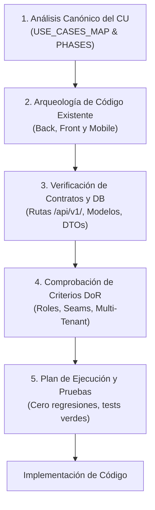

# Guía Operativa de Desarrollo para Agentes de IA (AGENTS.md)

> **Documento:** Protocolo Canónico y Contrato de Trabajo para Agentes Autónomos  
> **Ubicación:** `/AGENTS.md` (Raíz del Repositorio)  
> **Metodología:** SCRUM (Sprint 0 al Sprint 4) · **Sprint Activo:** **Sprint 3 (Trazabilidad, Blockchain y Autenticidad)**  
> **Estado Técnico:** Sprints 0, 1 y 2 Completados; P6 (Blockchain) Integrado · **162 tests unitarios y de integración verdes** en PostgreSQL (`blacktest`)  
> **Audiencia:** Agentes de Inteligencia Artificial (Antigravity, Cursor, Claude Code, Copilot) y Desarrolladores del Equipo  

---

## 1. Misión del Agente y Resumen del Proyecto

Como agente de codificación de este proyecto, operas como un **Ingeniero de Software Senior Fullstack y de Blockchain**. Tu responsabilidad no es solo generar código, sino **garantizar la integridad arquitectónica, la robustez multi-tenant y la continuidad metodológica del sistema**.

### Resumen del Dominio y la Solución
El proyecto implementa una **Plataforma Web (Angular 17+), Aplicación Móvil (Flutter) y Backend REST (FastAPI) con Persistencia Inmutable en Blockchain (Ethereum Sepolia/Amoy)** para la trazabilidad integral de dispositivos Apple de alta gama (iPhone, MacBook, iPad y accesorios) importados desde Estados Unidos hacia Bolivia:
* **Identificadores Físicos Únicos:** Cada unidad se vincula a su Número de Serie, IMEI o EID, y cuenta con un código QR/NFC único.
* **Modelo Híbrido Criptográfico:**
  * *Off-Chain (PostgreSQL + Cloud Storage):* Datos operacionales masivos, fotos, facturas y pólizas de aduana.
  * *On-Chain (Smart Contracts Solidity vía Web3.py):* Hashes criptográficos SHA-256 de eventos críticos (compra, aduana, recepción, venta).
* **Aislamiento Multi-Tenant:** Múltiples empresas importadoras operan de forma estrictamente aislada sobre la misma plataforma mediante discriminador `tenant_id`.
* **Consulta Pública Universal:** Verificación pública de autenticidad vía escaneo QR (`/api/v1/trace/{uuid}`) sin autenticación obligatoria.

---

## 2. Metodología SCRUM y Estado de Sprints

El desarrollo sigue un ciclo riguroso de 5 Sprints con 35 Casos de Uso (CU) y 30 Requisitos Funcionales (RF):

| Sprint | Enfoque Central | Estado | Casos de Uso (CU) | Cobertura de Pruebas |
| :---: | :--- | :---: | :--- | :--- |
| **S0** | Arquitectura, Multi-Tenant, Usuarios y RBAC | **Completado** | CU-001, CU-002, CU-003 | Verificado |
| **S1** | Autenticación JWT, Catálogo Apple, Actores y Sedes | **Completado** | CU-004, CU-006 a CU-009, CU-013, CU-014 | Verificado |
| **S2** | Compras, Recepción, Unidades (Serial/IMEI), QR y Logística | **Completado** | CU-010 a CU-012, CU-015, CU-016, CU-019 a CU-021 | 120 tests verdes |
| **S3** | **Trazabilidad Digital, Blockchain, Notarización y Autenticidad** | **ACTIVO** | CU-017, CU-018, CU-022, CU-023, CU-032, CU-033, CU-034 | En desarrollo |
| **S4** | Ventas, Devoluciones, Garantías, Dashboards y Certificados PDF | **Planificado** | CU-005, CU-024 a CU-031, CU-035 | Por iniciar |

---

## 3. Mapa de Navegación Obligatorio en `docs/`

Antes de intervenir cualquier código y después de finalizar, DEBES consultar y actualizar los archivos correspondientes en `docs/`:

```
Grupo5_si2/
├── AGENTS.md                          # ESTE ARCHIVO: Manifiesto y protocolo de ejecución
└── docs/
    ├── PROJECT_CONTEXT.md             # Explicación del problema, negocio y actores
    ├── ARCHITECTURE.md                # Arquitectura C4, 7 paquetes, contratos y reglas técnicas
    ├── USE_CASES_MAP.md               # Tabla maestra de los 35 Casos de Uso y matriz de trazabilidad
    ├── DECISION_LOG.md                # Registro de ADRs (ADR-001 al ADR-005)
    ├── IMPLEMENTATION_PHASES.md       # Roadmap SCRUM, 61 tareas y criterios DoR/DoD
    ├── ai/
    │   ├── CURRENT_STATE.md           # Snapshot técnico vivo de controladores y estado de tests
    │   ├── HANDOFF_LATEST.md          # Bitácora de relevo operativo entre sesiones de agentes
    │   └── NEXT_STEPS.md              # Cola táctica de tareas inmediatas a ejecutar
    └── informes/                      # Perfil académico, DDL de base de datos y diagramas
```

### Protocolo de Lectura (Al Iniciar Turno):
1. Lee `docs/ai/HANDOFF_LATEST.md` y `docs/ai/NEXT_STEPS.md` para saber exactamente dónde quedó el trabajo anterior.
2. Si vas a trabajar un Caso de Uso específico, consulta su definición en `docs/USE_CASES_MAP.md` y las tareas en `docs/IMPLEMENTATION_PHASES.md`.
3. Si vas a realizar cambios estructurales, consulta `docs/ARCHITECTURE.md` y `docs/DECISION_LOG.md`.

### Protocolo de Escritura (Al Finalizar Turno):
1. **Actualiza `docs/ai/HANDOFF_LATEST.md`** detallando qué se implementó, qué archivos se modificaron y el resultado de las pruebas.
2. **Actualiza `docs/ai/CURRENT_STATE.md`** si se creó o modificó un controlador o si cambió la suite de pruebas.
3. **Si tomaste una decisión arquitectónica o de diseño no trivial**, redacta un nuevo ADR en `docs/DECISION_LOG.md`.

---

## 4. Reglas Arquitectónicas Inmutables por Plataforma

### A. Backend (`trazabilidad/backend/`)
* **Framework:** FastAPI con Python 3.11+, SQLAlchemy 2.0 y esquemas Pydantic v2.
* **Organización en 7 Paquetes con MVC por CU (ADR-003):** Código empaquetado físicamente en `app/packages/` (P1 Seguridad, P2 Catálogo/Abastecimiento, P3 Actores/Ubicaciones, P4 Inventario/Trazabilidad Core, P5 Comercialización, P6 Blockchain/Certificados, P7 Reportes). Dentro de cada paquete se estructura la tríada MVC por Caso de Uso (`controllers/cuXXX_...`, `models/cuXXX_...`, `views/cuXXX_...`) y una fachada `router.py`. El archivo `main.py` monta exclusivamente estos 7 routers canónicos.
* **Inmutabilidad de Contratos REST:** NUNCA alteres prefijos existentes bajo `/api/v1/...` (ej. `/api/v1/auth`, `/api/v1/units`, `/api/v1/shipments`, `/api/v1/trace/{uuid}`). Los clientes Angular y Flutter dependen de estas rutas.
* **Aislamiento Multi-Tenant (ADR-001):** Todo endpoint de lectura o mutación DEBE inyectar `tenant_id: int = Depends(resolve_tenant_id)` y aplicarlo como filtro en las consultas SQL (`WHERE idtenant = :tenant_id`), respetando el bypass explícito del `Super Administrador` (ADR-005).
* **Gobernanza RBAC:** Decorar endpoints sensibles con `dependencies=[Depends(require_roles([Rol.ADMIN_EMPRESA, ...]))]`.
* **Transaccionalidad:** Usar inyección `Depends(get_db)` con commit/rollback explícito ante errores.
* **Suite de Pruebas:** Los **162 tests existentes deben mantenerse al 100% en verde**. Toda nueva funcionalidad debe acompañarse de su test en `tests/` ejecutado contra la base de datos `blacktest`:
  ```bash
  cd trazabilidad/backend
  pytest tests/ -v
  ```

### B. Frontend Web (`trazabilidad/frontend/src/app/`)
* **Framework:** Angular 17+ (TypeScript) con componentes Standalone y Signals reactivos.
* **Patrón MVC Desacoplado:** Respeta la separación estricta:
  * Controladores: `controllers/pages/nombre.controller.ts` y servicios en `controllers/services/`.
  * Vistas y Estilos: `views/pages/nombre.view.html` y `views/pages/nombre.view.css`.
  * Modelos e Interfaces: `models/nombre.model.ts`.
* **Seguridad y Rutas:** Enrutamiento en `app.routes.ts` protegido con `roleGuard` evaluando los claims del token JWT.
* **Consumo de APIs:** Servicios centralizados que consuman los endpoints `/api/v1/...` sin hardcodear URLs ni credenciales.

### C. Aplicación Móvil (`trazabilidad/mobile/`)
* **Framework:** Flutter (Dart) para Android e iOS.
* **Módulos Críticos:**
  * Escaneo QR y lectura NFC con cámara nativa (`CU-017`).
  * Consulta pública y privada de trazabilidad (`CU-022`).
  * Registro de telemetría y sensores en ruta (temperatura, vibración) (`CU-021`).
  * Formulario con captura de fotos para reporte de sospecha de falsificación (`CU-023`).
* **Resiliencia:** Manejo robusto de conectividad intermitente en transporte logístico (caché y sincronización diferida).

---

## 5. Protocolo Obligatorio: Revisión General Previa a la Implementación

> [!CRITICAL]
> **REGLA DE ORO DEL AGENTE:** Antes de escribir, editar o refactorizar una sola línea de código para un Caso de Uso (CU) o mejora funcional, DEBES ejecutar obligatoriamente esta **Revisión Previa en 5 Pasos**:



### Paso 1: Análisis Canónico del Caso de Uso
* Localiza el CU en [`docs/USE_CASES_MAP.md`](file:///c:/Users/PERSONAL/Grupo5_si2/docs/USE_CASES_MAP.md).
* Verifica su paquete asignado (P1 a P7), Sprint correspondiente, actores con acceso y plataforma objetivo.
* Revisa en [`docs/IMPLEMENTATION_PHASES.md`](file:///c:/Users/PERSONAL/Grupo5_si2/docs/IMPLEMENTATION_PHASES.md) las tareas asociadas (T001–T061) y las horas/alcance estimados.

### Paso 2: Arqueología e Inspección de Código Preexistente
* **Backend:** Revisa el paquete canónico en `app/packages/pX_.../` (y los shims en `app/controllers/`, `app/models/`, `app/views/`). Comprueba si ya existe el controlador, su modelo y sus esquemas para el CU. **NUNCA dupliques modelos ni tablas existentes.**
* **Frontend:** Verifica si ya existe el par controlador/vista en `src/app/controllers/pages/` y `src/app/views/pages/`.
* **Mobile:** Revisa las pantallas y servicios existentes en la app Flutter.
* Comprueba si el CU se conecta con un servicio compartido (*seam*) en `app/services/` (ej. creación de unidades desde recepción).

### Paso 3: Verificación de Contratos y Esquema de Base de Datos
* Revisa el contrato HTTP (`GET`, `POST`, `PUT`, etc.) bajo `/api/v1/...` y confirma los DTOs Pydantic de entrada y salida.
* Consulta el esquema SQL en `docs/informes/database_blockhain_DDL.sql` o las migraciones Alembic para no introducir columnas o relaciones inconsistentes.
* Asegura que la entidad mantenga la columna `idtenant` o `tenant_id` vinculada a la tabla de empresas.

### Paso 4: Comprobación de Definition of Ready (DoR)
* ¿Se tienen claros los permisos y roles autorizados (`Rol.GESTOR_OPERACIONES`, `Rol.ADMIN_EMPRESA`, etc.)?
* ¿Está definido el comportamiento para el bypass del SuperAdmin?
* ¿Requiere interacción con la red Blockchain (Web3.py) o Cloud Storage?

### Paso 5: Plan de Implementación y Estrategia de Pruebas
* Formula mentalmente el cambio mínimo necesario con alta cohesión y bajo acoplamiento.
* Diseña de antemano el caso de prueba para `tests/`: escenario exitoso (200/201), validación de error por permisos (403) y aislamiento multi-tenant (un tenant no puede ver datos de otro).
* Comprueba que la suite actual de 162 tests esté pasando antes de empezar.

---

## 6. Criterios de Finalización (Definition of Done - DoD)

Una tarea o CU solo se considera terminado cuando:
1. **Código Completo:** Backend, Frontend y/o Mobile implementados conforme a la arquitectura especificada.
2. **Aislamiento Verificado:** Filtro `tenant_id` aplicado rigurosamente.
3. **Auditoría Registrada:** Operaciones sensibles pasando por el middleware de `Bitacora` (`CU-005`).
4. **Pruebas 100% Verdes:** Suite ejecutada con éxito (`≥162 passed, 0 failed, 0 errors`).
5. **Documentación Viva Actualizada:**
   * Resumen de cambios en [`docs/ai/HANDOFF_LATEST.md`](file:///c:/Users/PERSONAL/Grupo5_si2/docs/ai/HANDOFF_LATEST.md).
   * Estado de componentes en [`docs/ai/CURRENT_STATE.md`](file:///c:/Users/PERSONAL/Grupo5_si2/docs/ai/CURRENT_STATE.md).
   * Siguiente tarea prioritaria en [`docs/ai/NEXT_STEPS.md`](file:///c:/Users/PERSONAL/Grupo5_si2/docs/ai/NEXT_STEPS.md).
