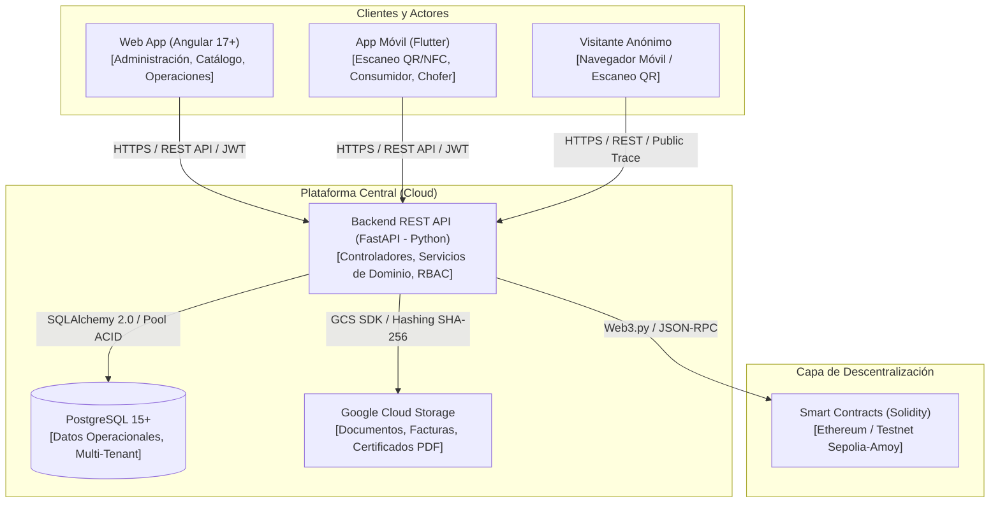
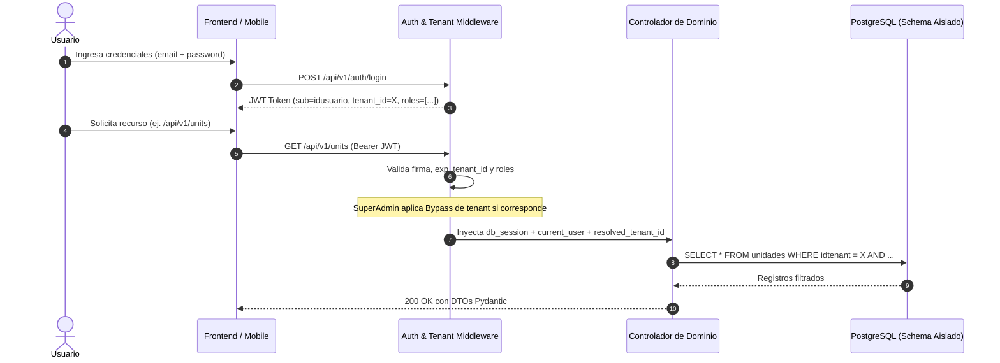
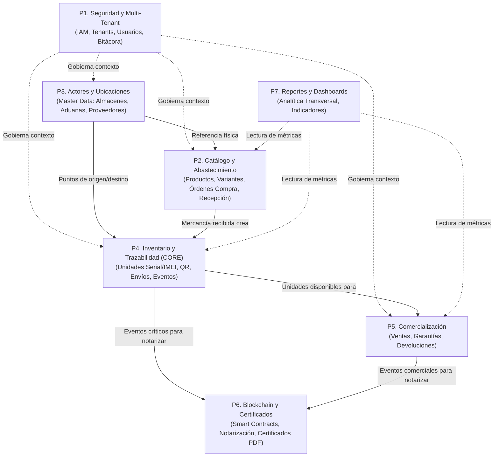

# Arquitectura del Sistema: Plataforma de Trazabilidad Blockchain para Dispositivos Apple

> **Documento:** Explicación y Referencia de Arquitectura (Diátaxis Framework)  
> **Estado:** Aprobado / En evolución controlada  
> **Audiencia:** Arquitectos de Software, Desarrolladores Fullstack y Agentes Autónomos de Codificación  

---

## 1. Visión General y Criterios Arquitectónicos

El sistema tiene como objetivo garantizar la autenticidad, procedencia inmutable y cadena de custodia de dispositivos Apple (iPhone, MacBook, iPad y accesorios) importados desde Estados Unidos hacia el mercado boliviano. La solución mitiga el riesgo de falsificación, contrabando y fraude mediante la vinculación de cada unidad física (Serial, IMEI, EID) a un registro distribuido e inmutable en blockchain y a un código QR/NFC único.

### Principios Rectores (Cimientos Sólidos)

1. **Inmutabilidad Criptográfica Selectiva (On-Chain vs. Off-Chain):**  
   Solo los eventos críticos de la cadena (compra en EE.UU., despacho aduanero, recepción, custodia logística y venta final) y sus hashes de verificación se registran en la blockchain. La información operativa, transaccional, metadatos y documentos binarios se gestionan off-chain en PostgreSQL y Cloud Storage.
2. **Aislamiento Estricto Multi-Tenant:**  
   Múltiples empresas importadoras operan sobre la misma infraestructura de software de manera totalmente aislada. Ninguna consulta operativa puede acceder a datos fuera del inquilino autenticado (`tenant_id`), salvo operaciones de auditoría global del SuperAdministrador.
3. **Módulos Profundos y Costuras Claras (*Deep Modules & Seams*):**  
   El backend organiza la complejidad en 7 paquetes funcionales con alta cohesión y bajo acoplamiento. La comunicación entre dominios se realiza a través de interfaces y servicios de dominio (*seams*), evitando dependencias circulares o mutaciones cruzadas directas en tablas de la base de datos.
4. **Respeto a Contratos de API REST:**  
   Todos los endpoints se exponen bajo el prefijo unificado `/api/v1/`. La modularización interna del código nunca debe provocar roturas en las rutas consumidas por el frontend web (Angular) ni por la app móvil (Flutter).

---

## 2. Vista de Contenedores y Tecnologías (C4 Nivel 2)



### Componentes Tecnológicos

* **Backend / API REST:** FastAPI (Python 3.11+). Asincronía nativa, esquemas Pydantic v2 para validación estricta y SQLAlchemy 2.0 con soporte transaccional ACID.
* **Base de Datos:** PostgreSQL con soporte para tipos JSONB e índices B-Tree sobre identificadores únicos (`serial_number`, `imei`, `eid`, `tenant_id`).
* **Frontend Web:** Angular (TypeScript) con arquitectura basada en componentes, servicios tipados y guards de enrutamiento por roles (`roleGuard`).
* **Aplicación Móvil:** Flutter (Dart) multiplataforma (Android/iOS) con integración nativa para cámara (escaneo QR) y chip NFC.
* **Blockchain:** Red Ethereum (Testnet pública Sepolia/Amoy en desarrollo), contratos inteligentes en Solidity y conectividad vía Web3.py.
* **Almacenamiento Off-chain:** Google Cloud Storage para archivos adjuntos, pólizas aduaneras, imágenes y certificados digitales en PDF.

---

## 3. Modelo Multi-Tenant y Seguridad



* **Mecanismo de Aislamiento:** Discriminador por columna (`idtenant` / `tenant_id`) en cada entidad de negocio, forzado mediante inyección de dependencias en FastAPI (`resolve_tenant_id`).
* **Gobernanza RBAC:** Decorador `require_roles(...)` sobre los endpoints de escritura para verificar pertenencia a roles autorizados (*Super Administrador, Administrador de Empresa, Gestor de Operaciones, Gestor de Ventas*).
* **Bypass de SuperAdministrador:** El Super Administrador posee acceso de auditoría total y gobernanza sobre cualquier tenant sin requerir un vínculo previo restrictivo, permitiendo el cambio dinámico de inquilino (*switch-tenant*).

---

## 4. Descomposición por los 7 Paquetes (Bounded Contexts)

La arquitectura de la solución distribuye los 35 Casos de Uso (CU) en **7 paquetes de dominio**. Cada paquete posee alta cohesión interna y límites explícitos:



### Detalle de Paquetes y Responsabilidades

| Paquete | CUs Cubiertos | Cohesión Interna | Acoplamiento Externo | Responsabilidad Principal |
| :--- | :--- | :--- | :--- | :--- |
| **P1. Seguridad y Multi-Tenant** | CU-001 al CU-005 | **Muy Alta** | Transversal | Autenticación, emisión JWT, gobernanza de inquilinos, RBAC y auditoría en bitácora. |
| **P2. Catálogo y Abastecimiento** | CU-006 al CU-012 | **Media-Alta** | P3 (Proveedores), P4 (Unidades) | Catálogo oficial Apple, variantes (color, capacidad, SKU), órdenes de compra y recepción física. |
| **P3. Actores y Ubicaciones** | CU-013, CU-014 | **Muy Alta** | Pasivo / Referencial | Catálogo maestro de entidades no autenticadas (proveedores EE.UU., transportistas, aduanas, almacenes). |
| **P4. Inventario y Trazabilidad (Núcleo)** | CU-015 al CU-024 | **Excelente (Core)** | P3 (Rutas), P6 (Blockchain) | Gestión de unidades físicas individuales (Serial/IMEI), generación de QR, eventos logísticos e incidencias. |
| **P5. Comercialización** | CU-025 al CU-032 | **Alta** | P4 (Unidades) | Registro de venta al consumidor final, pólizas de garantía por serial, devoluciones y documentos adjuntos. |
| **P6. Blockchain y Certificados** | CU-033, CU-034 | **Muy Alta** | Adaptador / Servicio | Emisión de transacciones hacia Ethereum, verificación criptográfica de integridad y generación de certificados PDF. |
| **P7. Reportes y Administración** | CU-035 | **Alta (Analítica)** | Solo Lectura (P1..P6) | Dashboards de KPIs, trazabilidad consolidada, tiempos de nacionalización y métricas de negocio. |

---

## 5. Organización del Backend: Modularización por Paquetes y Patrón MVC por Caso de Uso

El backend (`trazabilidad/backend/app/`) implementa una arquitectura híbrida de **Módulos Profundos (Bounded Contexts) y MVC Desacoplado**: el sistema se organiza físicamente en los **7 paquetes de dominio** canónicos bajo `app/packages/` (en cumplimiento del [ADR-003](file:///c:/Users/PERSONAL/Grupo5_si2/docs/DECISION_LOG.md)), y al interior de cada paquete se estructura la lógica siguiendo el patrón **MVC por Caso de Uso (CU)**:

```
trazabilidad/backend/app/
├── core/                               # Configuraciones globales, seguridad JWT, settings
├── db/                                 # Conexión SQLAlchemy, Base declarativa, sesiones
├── services/                           # Contratos e Interfaces entre Dominios (Seams)
├── packages/                           # 7 PAQUETES CANÓNICOS DE DOMINIO
│   ├── p1_seguridad/                   # Paquete 1: Seguridad y Multi-Tenant (CU-001 al CU-005)
│   │   ├── controllers/                # Controladores FastAPI por CU (cu001, cu002, cu003, ...)
│   │   ├── models/                     # Modelos ORM SQLAlchemy 2.0 por CU
│   │   ├── views/                      # Esquemas Pydantic v2 (DTOs Request/Response) por CU
│   │   └── router.py                   # Fachada que agrupa y expone los sub-routers de P1
│   ├── p2_catalogo/                    # Paquete 2: Catálogo y Abastecimiento (CU-006 al CU-012)
│   │   ├── controllers/                # cu006_productos, cu007_certificaciones, cu010_compras, ...
│   │   ├── models/
│   │   ├── views/
│   │   └── router.py                   # Fachada que agrupa y expone los sub-routers de P2
│   ├── p3_actores/                     # Paquete 3: Actores y Ubicaciones (CU-013, CU-014)
│   │   ├── controllers/                # cu013_actores_cadena, cu014_ubicaciones
│   │   ├── models/
│   │   ├── views/
│   │   └── router.py                   # Fachada que agrupa y expone los sub-routers de P3
│   ├── p4_trazabilidad/                # Paquete 4: Inventario y Trazabilidad CORE (CU-015 al CU-024)
│   │   ├── controllers/                # cu015_unidades, cu016_qr, cu019_envios, cu021_eventos, ...
│   │   ├── models/
│   │   ├── views/
│   │   └── router.py                   # Fachada que agrupa y expone los sub-routers de P4
│   ├── p5_comercial/                   # Paquete 5: Comercialización (CU-025 al CU-032)
│   │   ├── controllers/                # cu032_documentos_unidad (y CUs comerciales planificados)
│   │   ├── models/
│   │   ├── views/
│   │   └── router.py                   # Fachada que agrupa y expone los sub-routers de P5
│   ├── p6_blockchain/                  # Paquete 6: Blockchain y Certificados (CU-033, CU-034)
│   │   ├── controllers/                # cu033_blockchain, cu034_certificados
│   │   ├── models/
│   │   ├── views/
│   │   └── router.py                   # Fachada que agrupa y expone los sub-routers de P6
│   └── p7_reportes/                    # Paquete 7: Reportes e Inteligencia (CU-035)
│       ├── controllers/
│       ├── models/
│       ├── views/
│       └── router.py                   # Fachada que agrupa y expone los sub-routers de P7
├── controllers/                        # Shims de compatibilidad hacia app/packages/
├── models/                             # Shims de compatibilidad hacia app/packages/
├── views/                              # Shims de compatibilidad hacia app/packages/
└── main.py                             # Punto de entrada limpio: registra exclusivamente los 7 routers
```

### Principios de la Implementación por Paquetes y MVC

1. **Estructura Interna por Caso de Uso:** Dentro de cada paquete (`p1` a `p7`), cada Caso de Uso se aisla en su propio submódulo dentro de `controllers/cuXXX_...`, `models/cuXXX_...` y `views/cuXXX_...`. Esto garantiza alta cohesión funcional, límites claros de responsabilidad y navegación intuitiva.
2. **Fachadas de Enrutamiento (`router.py`):** Cada paquete expone un único archivo `router.py` que consolida los sub-enrutadores de sus Casos de Uso. El archivo [main.py](file:///c:/Users/PERSONAL/Grupo5_si2/trazabilidad/backend/app/main.py) únicamente monta estos 7 routers canónicos bajo el prefijo `/api/v1`, reduciendo la dispersión de rutas en el bootstrap de la aplicación:
   ```python
   app.include_router(p1_seguridad_router, prefix="/api/v1")
   app.include_router(p2_catalogo_router, prefix="/api/v1")
   app.include_router(p3_actores_router, prefix="/api/v1")
   app.include_router(p4_trazabilidad_router, prefix="/api/v1")
   app.include_router(p5_comercial_router, prefix="/api/v1")
   app.include_router(p6_blockchain_router, prefix="/api/v1")
   app.include_router(p7_reportes_router, prefix="/api/v1")
   ```
3. **Cero Rotura de Contratos REST:** Todos los endpoints HTTP conservan sus rutas y prefijos originales (`/api/v1/auth`, `/api/v1/units`, `/api/v1/shipments`, etc.), garantizando que los clientes Angular y Flutter continúen operando sin ninguna modificación.
4. **Shims de Compatibilidad Regresiva:** Para mantener la compatibilidad con imports históricos, tests y scripts existentes, se preservan shims en `app/controllers/`, `app/models/` y `app/views/` que redirigen de forma transparente a las rutas dentro de `app/packages/`.
5. **Preservación y Crecimiento de Pruebas:** La suite automatizada de pruebas en pytest se mantiene 100% verde (creciendo a **162 tests verificados y aprobados**), validando tanto los módulos de S0–S2 como los nuevos servicios de Blockchain y Certificados de P6.
6. **Seams (Costuras) entre Dominios:** Cuando un paquete requiere capacidades de otro (por ejemplo, el flujo de recepción en P2 creando unidades físicas en P4), la interacción se gestiona a través de interfaces de servicio desacopladas en `app/services/` (evitando acoplamientos circulares o mutaciones directas entre modelos de distintos paquetes).

---

## 6. Organización del Frontend Web (Angular 17+)

La aplicación web administrativa (`trazabilidad/frontend/src/app/`) adopta un patrón **MVC Homogéneo** desacoplado para mantener consistencia conceptual con el backend:

```
trazabilidad/frontend/src/app/
├── core/                       # Guards de autenticación y roles, interceptores HTTP
├── models/                     # Interfaces y contratos tipados TypeScript
├── controllers/                # Lógica de componentes y servicios HTTP
│   ├── auth/                   # Controladores de acceso y recuperación
│   ├── pages/                  # 21 controladores (@Component clases TypeScript)
│   └── services/               # Servicios inyectables Angular (HttpClient y Signals)
├── views/                      # Capa de presentación visual desacoplada
│   ├── auth/                   # Vistas HTML y estilos de login
│   └── pages/                  # 21 pares de plantillas (.view.html y .view.css)
├── app.config.ts               # Proveedores globales y configuración standalone
├── app.routes.ts               # Definición de rutas protegidas (roleGuard)
└── app.ts                      # Shell principal de la aplicación
```

* **Separación Controller-View:** Las clases `@Component` residen en `controllers/pages/X.controller.ts`, vinculando explícitamente sus plantillas en `views/pages/X.view.html` y `views/pages/X.view.css`.
* **Manejo de Estado con Signals:** Los controladores consumen el estado reactivo mediante Angular Signals expuestos desde `controllers/services/`.
* **Seguridad en Rutas:** Enrutamiento centralizado en `app.routes.ts` con protección por `roleGuard` evaluando los claims del JWT.

---

## 7. Organización de la Aplicación Móvil (Flutter)

La app móvil (`trazabilidad/mobile/lib/`) refleja exactamente la misma estructura por capas para facilitar el mantenimiento multiplataforma:

```
trazabilidad/mobile/lib/
├── core/                       # api_config.dart, secure_storage.dart (Tokens JWT)
├── models/                     # 13 entidades Dart con fromJson / toJson
├── controllers/                # Gestores de estado y clientes HTTP
│   ├── *_controller.dart       # Controladores de UI y ciclo de vida
│   └── *_service.dart          # Clientes HTTP (comunicación con FastAPI)
├── views/                      # Pantallas principales (Widgets Stateful / Stateless)
│   ├── widgets/                # Hojas modales, bottom sheets y widgets reusables
│   └── *_view.dart             # Screens (login, qr_scanner, trace_history, etc.)
└── main.dart                   # Inicialización, temas y rutas móviles
```

* **Persistencia Segura:** Uso de `flutter_secure_storage` para retener tokens JWT en el keychain/keystore del dispositivo.
* **Capacidades Nativas:** Integración de cámara para escaneo QR/NFC en `views/qr_scanner_view.dart` y telemetría de transporte en `views/record_transport_event_view.dart`.

---

## 8. Arquitectura Blockchain: Modelo On-Chain vs. Off-Chain

```mermaid
flowchart LR
    subgraph OffChain ["Capa Operativa Off-Chain"]
        Unidad["Unidad Física\n(Serial + IMEI)"]
        EventoOp["Evento Operativo\n(Paso Aduanero / Recepción)"]
        PayloadJson["Metadatos Extendidos\n(Temperatura, Humedad, Firma Operador)"]
    end

    subgraph HashEngine ["Generación de Evidencia"]
        SHA256["Cálculo de Hash SHA-256\n(Payload + Timestamp + Tenant)"]
    end

    subgraph OnChain ["Capa Inmutable On-Chain (Ethereum)"]
        Contract["Smart Contract (Solidity)"]
        BlockEntry["Registro Transacción\n- uint256 idUnidad\n- bytes32 dataHash\n- uint256 timestamp\n- address registrador"]
    end

    Unidad --> EventoOp
    EventoOp --> PayloadJson
    PayloadJson --> SHA256
    SHA256 -->|Web3.py (Transacción firmada)| Contract
    Contract --> BlockEntry
```

### Estructura del Smart Contract de Trazabilidad

Cada registro en la red Ethereum almacena una tupla criptográfica mínima para optimizar el consumo de gas:
* `unitId`: Identificador numérico o serial normalizado del dispositivo.
* `eventHash`: Digest SHA-256 de los metadatos completos almacenados en la base de datos relacional.
* `eventType`: Código numérico que tipifica el evento (1=Compra EE.UU., 2=Embarque, 3=Aduana, 4=Almacén, 5=Venta).
* `timestamp`: Marca de tiempo Unix inmutable asignada por el bloque.
* `operator`: Dirección pública (Ethereum Address) del custodio o empresa responsable.

Cualquier consumidor o auditor puede contrastar los datos visibles en su comprobante o PDF contra el `eventHash` minado en la blockchain, certificando que los datos no han sufrido alteración alguna.
