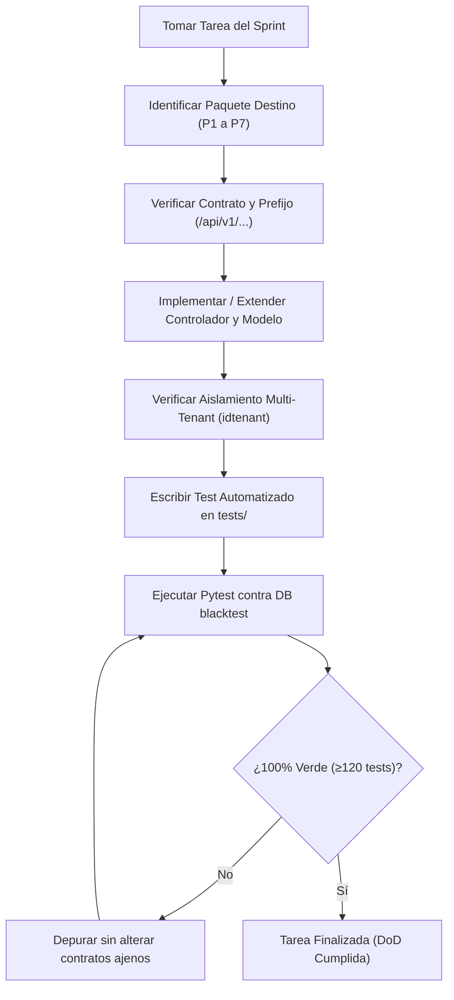

# Fases de Implementación y Roadmap de Sprints

> **Documento:** Guía de Ejecución y Hoja de Ruta (Diátaxis Framework)  
> **Metodología:** SCRUM con seguimiento en Jira · **Equipo:** Grupo 5  
> **Alcance:** 5 Sprints (Sprint 0 al Sprint 4), 35 Casos de Uso (CU), 61 Tareas (T001–T061), 271 Horas  
> **Audiencia:** Scrum Master, Desarrolladores Fullstack y Agentes Autónomos de Codificación  

---

## 1. Marco Metodológico y Criterios de Calidad

El desarrollo del sistema de trazabilidad blockchain se ejecuta de forma iterativa e incremental en 5 Sprints bajo el marco de trabajo SCRUM. Para garantizar que cada entrega preserve la integridad arquitectónica y la suite de pruebas automatizadas, se establecen los siguientes criterios obligatorios:

### Definition of Ready (DoR) — Antes de iniciar una Tarea / CU
1. **Límites de Dominio Claros:** El Caso de Uso debe estar asignado formalmente a uno de los 7 paquetes (P1 a P7).
2. **Contratos Definidos:** Los esquemas Pydantic (Request/Response) y las rutas HTTP (`/api/v1/...`) deben estar especificados antes de escribir lógica.
3. **Roles y Permisos Mapeados:** Se debe conocer qué roles tienen permiso de lectura y cuáles de escritura (`require_roles`).
4. **Dependencias Resueltas:** Si el CU interactúa con otro paquete (ej. Recepción hacia Unidades), la interfaz o *seam* del paquete proveedor debe estar disponible.

### Definition of Done (DoD) — Para dar por concluida una Tarea / CU
1. **Código Implementado:** Controlador FastAPI, modelo SQLAlchemy 2.0 y esquemas Pydantic funcionales.
2. **Aislamiento Multi-Tenant:** Toda consulta de lectura/escritura filtra estrictamente por `tenant_id` (salvo bypass explícito de SuperAdmin).
3. **Auditoría Automática:** Endpoints sensibles integrados con el middleware de bitácora (`CU-005`).
4. **Pruebas Automatizadas Verdes:** Tests unitarios y de integración agregados en `trazabilidad/backend/tests/` ejecutados exitosamente con `pytest` contra la base de datos de prueba (`blacktest`).
5. **Cero Regresiones:** Los tests previos (actualmente 120 tests pasando) deben mantenerse en verde (`100% passed`).

---

## 2. Matriz de Trazabilidad: Sprints vs. Paquetes

| Sprint | Objetivo Central | Paquetes Involucrados | Casos de Uso (CU) | Cant. CUs | Estado Actual |
| :---: | :--- | :--- | :--- | :---: | :---: |
| **S0** | Arquitectura, Multi-Tenant, Usuarios y Roles | **P1** | CU-001, CU-002, CU-003 | 3 | **Completado / Auditado** |
| **S1** | Autenticación, Catálogo y Actores | **P1, P2, P3** | CU-004, CU-006, CU-007, CU-008, CU-009, CU-013, CU-014 | 7 | **Completado / Auditado** |
| **S2** | Compras, Unidades Físicas y Logística | **P2, P4** | CU-010, CU-011, CU-012, CU-015, CU-016, CU-019, CU-020, CU-021 | 8 | **Completado (120/120 Tests)** |
| **S3** | Trazabilidad Digital, Blockchain y Autenticidad | **P4, P5, P6** | CU-017, CU-018, CU-022, CU-023, CU-032, CU-033, CU-034 | 7 | **Próximo / En Desarrollo** |
| **S4** | Comercialización, Devoluciones, Reportes | **P1, P4, P5, P7** | CU-005, CU-024, CU-025, CU-026, CU-027, CU-028, CU-029, CU-030, CU-031, CU-035 | 10 | **Planificado** |

---

## 3. Desglose Detallado de Tareas por Sprint

### Sprint 0: Arquitectura, Empresas, Usuarios y Roles (57 horas)
*Estado: Completado y auditado.*

| ID | Rol | Tarea / Funcionalidad | Plataforma | Horas | Paquete |
| :--- | :--- | :--- | :--- | :---: | :---: |
| **T001** | Dev Team (Arq) | Definición de la arquitectura general del sistema | Arquitectura | 5 | Base |
| **T002** | Dev Team (Backend) | Configuración inicial del proyecto Backend con FastAPI | Backend | 4 | Base |
| **T003** | Dev Team (Frontend) | Configuración inicial de la plataforma Web con Angular | Web | 4 | Base |
| **T004** | Dev Team (Mobile) | Configuración inicial de la aplicación Móvil con Flutter | Móvil | 4 | Base |
| **T005** | Dev Team (Backend) | Configuración de la conexión con PostgreSQL y Alembic | Backend | 4 | Base |
| **T006** | Dev Team (Backend) | Diseño del modelo de datos para empresas, usuarios, roles y productos | DB | 5 | P1 |
| **T007** | Dev Team (Backend) | Definición de entidades y relaciones principales del sistema | DB | 4 | P1 |
| **T008** | Dev Team (Backend) | Gestión de empresas y configuración multi-tenant (API REST) | Backend | 5 | P1 |
| **T009** | Dev Team (Frontend) | Interfaz de gestión de empresas (UI Angular) | Web | 4 | P1 |
| **T010** | Dev Team (Backend) | Gestión de usuarios del sistema (API REST) | Backend | 5 | P1 |
| **T011** | Dev Team (Frontend) | Interfaz de administración de usuarios (UI Angular) | Web | 4 | P1 |
| **T012** | Dev Team (Backend) | Roles y permisos de usuarios (RBAC) | Backend | 5 | P1 |
| **T013** | Dev Team (Frontend) | Interfaz de asignación de roles y permisos (UI Angular) | Web | 4 | P1 |

---

### Sprint 1: Autenticación y Gestión de Productos (51 horas)
*Estado: Completado y auditado.*

| ID | Rol | Tarea / Funcionalidad | Plataforma | Horas | Paquete |
| :--- | :--- | :--- | :--- | :---: | :---: |
| **T014** | Dev Team (Backend) | Autenticación y recuperación de contraseña (JWT + OAuth2) | Backend | 5 | P1 |
| **T015** | Dev Team (Frontend) | Interfaz de inicio de sesión y recuperación de contraseña | Web | 4 | P1 |
| **T016** | Dev Team (Mobile) | Interfaz de autenticación de usuarios en Flutter | Móvil | 4 | P1 |
| **T017** | Dev Team (Backend) | Gestión de productos y variantes Apple (API REST) | Backend | 5 | P2 |
| **T018** | Dev Team (Frontend) | Interfaz de registro y edición de productos y variantes | Web | 5 | P2 |
| **T019** | Dev Team (Backend) | Categorías y atributos de productos (API REST) | Backend | 4 | P2 |
| **T020** | Dev Team (Frontend) | Interfaz de gestión de categorías y catálogo por empresa | Web | 4 | P2 |
| **T021** | Dev Team (Backend) | Certificaciones técnicas y garantías (API REST) | Backend | 4 | P2 |
| **T022** | Dev Team (Frontend) | Interfaz de gestión de certificaciones técnicas | Web | 4 | P2 |
| **T023** | Dev Team (Backend) | Gestión de actores de la cadena de suministro (API REST) | Backend | 4 | P3 |
| **T024** | Dev Team (Backend) | Gestión de ubicaciones físicas y almacenes (API REST) | Backend | 4 | P3 |
| **T025** | Dev Team (Frontend) | Interfaz de actores y ubicaciones físicas | Web | 4 | P3 |

---

### Sprint 2: Compras, Unidades y Logística (53 horas)
*Estado: Completado — 25/25 tests de CU verificados, suite total de 120 tests en verde.*

| ID | Rol | Tarea / Funcionalidad | Plataforma | Horas | Paquete |
| :--- | :--- | :--- | :--- | :---: | :---: |
| **T026** | Dev Team (Backend) | Gestión de órdenes de compra a proveedores EE.UU. | Backend | 5 | P2 |
| **T027** | Dev Team (Frontend) | Interfaz de creación y consulta de órdenes de compra | Web | 4 | P2 |
| **T028** | Dev Team (Backend) | Flujo de aprobación y rechazo de órdenes de compra | Backend | 4 | P2 |
| **T029** | Dev Team (Backend) | Recepción de mercancía y actualización de existencias | Backend | 5 | P2 |
| **T030** | Dev Team (Frontend) | Interfaz de recepción y consulta de mercancía | Web | 4 | P2 |
| **T031** | Dev Team (Backend) | Registro y gestión de unidades individuales Apple | Backend | 5 | P4 |
| **T032** | Dev Team (Backend) | Asignación de identificadores (Serial / IMEI / EID) | Backend | 4 | P4 |
| **T033** | Dev Team (Frontend) | Interfaz de administración de unidades individuales | Web | 4 | P4 |
| **T034** | Dev Team (Backend) | Generación de códigos QR únicos por unidad | Backend | 4 | P4 |
| **T035** | Dev Team (Frontend) | Interfaz de generación y descarga de códigos QR | Web | 4 | P4 |
| **T036** | Dev Team (Backend) | Envíos logísticos, movimientos y asignación de unidades | Backend | 5 | P4 |
| **T037** | Dev Team (Mobile) | Registro de recepción, transporte y condiciones (App) | Móvil | 5 | P4 |

---

### Sprint 3: Trazabilidad, Blockchain y Autenticidad (55 horas)
*Estado: En Desarrollo / Foco Inmediato.*

| ID | Rol | Tarea / Funcionalidad | Plataforma | Horas | Paquete |
| :--- | :--- | :--- | :--- | :---: | :---: |
| **T038** | Dev Team (Backend) | Registro de eventos de trazabilidad y condiciones (API REST) | Backend | 5 | P4 |
| **T039** | Dev Team (Blockchain) | Conexión con la red Blockchain Ethereum (Testnet Sepolia/Amoy) | Blockchain | 4 | P6 |
| **T040** | Dev Team (Blockchain) | Diseño del Smart Contract (Solidity) para notarización | Blockchain | 5 | P6 |
| **T041** | Dev Team (Blockchain) | Minado y registro de eventos mediante Smart Contract | Blockchain | 5 | P6 |
| **T042** | Dev Team (Backend) | Integración de FastAPI con Web3.py y Smart Contract | Backend | 5 | P6 |
| **T043** | Dev Team (Backend) | Asociación de eventos con actor, ubicación, fecha y txHash | Backend | 4 | P4 |
| **T044** | Dev Team (Backend) | Persistencia de hashes e identificadores blockchain en PostgreSQL | Backend | 4 | P4 / P6 |
| **T045** | Dev Team (Blockchain) | Consulta y validación de integridad criptográfica | Blockchain | 5 | P6 |
| **T046** | Dev Team (Mobile) | Escaneo de códigos QR mediante cámara (Flutter) | Móvil | 4 | P4 |
| **T047** | Dev Team (Mobile) | Consulta del historial de trazabilidad mediante QR (Flutter) | Móvil | 5 | P4 |
| **T048** | Dev Team (Backend) | Verificación de autenticidad y reporte de falsificación | Backend | 5 | P4 |
| **T049** | Dev Team (Backend) | Carga y asociación de documentos a unidades (Cloud Storage) | Backend | 4 | P5 |

---

### Sprint 4: Ventas, Consumidor, Devoluciones y Reportes (55 horas)
*Estado: Planificado.*

| ID | Rol | Tarea / Funcionalidad | Plataforma | Horas | Paquete |
| :--- | :--- | :--- | :--- | :---: | :---: |
| **T050** | Dev Team (Backend) | Gestión de ventas y asignación de unidades (Serial/IMEI) | Backend | 5 | P5 |
| **T051** | Dev Team (Frontend) | Interfaz de gestión de ventas y unidades asociadas | Web | 5 | P5 |
| **T052** | Dev Team (Backend) | Pagos y registro de transacciones referenciales | Backend | 5 | P5 |
| **T053** | Dev Team (Backend) | Devoluciones y asignación de unidades devueltas | Backend | 5 | P5 |
| **T054** | Dev Team (Frontend) | Interfaz de devoluciones y garantías por unidad | Web | 4 | P5 |
| **T055** | Dev Team (Backend) | Gestión de pólizas de garantía por unidad (API REST) | Backend | 4 | P5 |
| **T056** | Dev Team (Backend) | Historial de compras, favoritos y preferencias | Backend | 4 | P5 |
| **T057** | Dev Team (Frontend) | Interfaz de historial de compras y preferencias | Web | 4 | P5 |
| **T058** | Dev Team (Backend) | Notificaciones push y alertas de incidencias | Backend | 5 | P4 |
| **T059** | Dev Team (Frontend) | Interfaz web de notificaciones y alertas | Web | 4 | P4 |
| **T060** | Dev Team (Backend) | Generación de certificados digitales PDF con hash blockchain | Backend | 5 | P6 / P7 |
| **T061** | Dev Team (Frontend) | Dashboard administrativo y visualización de reportes (KPIs) | Web | 5 | P7 |

---

## 4. Guía Operativa para Agentes de Codificación

Cuando un agente autónomo tome una tarea del backlog, debe adherirse estrictamente al siguiente protocolo de ejecución:



### Reglas Críticas de Desarrollo
1. **Nunca alterar rutas existentes:** No modifiques rutas como `/api/v1/auth/login`, `/api/v1/units`, o `/api/v1/trace/{uuid}`. Cualquier cambio romperá la compatibilidad con el frontend y los clientes móviles.
2. **Harness de Pruebas:** Ejecutar siempre las pruebas con:
   ```bash
   pytest tests/ -v
   ```
   Asegurando que la variable `DATABASE_URL` apunte a la base de datos de pruebas configurada (PostgreSQL `blacktest`).
3. **Manejo de Transacciones:** Toda operación en base de datos debe ejecutarse dentro de un bloque `with SessionLocal() as db:` o inyectada con `Depends(get_db)`, asegurando `db.commit()` y rollback automático ante excepciones.
