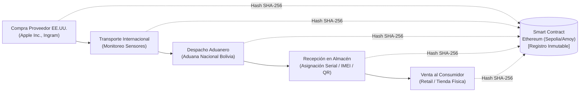
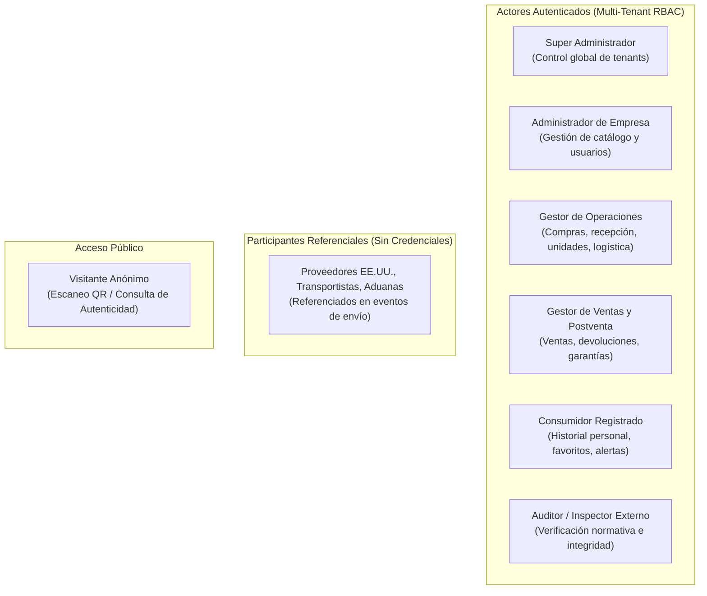

# Contexto del Proyecto: Trazabilidad Blockchain para Dispositivos Apple

> **Documento:** Explicación y Contexto de Negocio (Diátaxis Framework)  
> **Ubicación:** `docs/PROJECT_CONTEXT.md`  
> **Metodología:** SCRUM · **Sprint Activo:** **Sprint 3 (Trazabilidad, Blockchain y Autenticidad)**  
> **Estado del Código:** Sprints 0, 1 y 2 **100% Implementados (120 tests verdes)**  
> **Audiencia:** Equipo de Desarrollo, Product Owner, Scrum Master y Agentes Autónomos  

---

## 1. El Problema de Negocio y Dominio

En Bolivia, el mercado de dispositivos Apple de alta gama (iPhone, MacBook, iPad y accesorios) depende en un 100% de canales de importación desde Estados Unidos. Sin embargo, este mercado enfrenta tres desafíos críticos:

1. **Asimetría de Información y Desconfianza:** El comprador final no puede comprobar si un dispositivo vendido a precio premium es genuino, legalmente importado o una réplica/dispositivo reacondicionado vendido como nuevo (*Problema de los Limones de Akerlof*).
2. **Falta de Trazabilidad en la Cadena Logística:** Los importadores locales carecen de registros confiables e integrados sobre el trayecto internacional, el paso por aduanas y las condiciones físicas del transporte (temperatura, humedad y vibraciones que afectan las baterías de litio y componentes ópticos).
3. **Vulnerabilidad de Registros Centralizados:** Las bases de datos convencionales o etiquetas adhesivas pueden ser manipuladas o adulteradas sin dejar evidencia criptográfica.

---

## 2. La Solución Tecnológica

El proyecto implementa una **Plataforma Web (Angular) y Aplicación Móvil (Flutter) con Backend REST (FastAPI) y Persistencia Inmutable en Blockchain (Ethereum)** que transforma cada dispositivo físico en un portador de su propia historia digital verificable:

### Pilares Fundamentales de la Solución
* **Identificadores Físicos Únicos:** Cada unidad se vincula individualmente a su Número de Serie de Apple, IMEI (para modelos con conectividad celular), EID (para eSIM) y recibe un código QR / tag NFC único.
* **Modelo Híbrido On-Chain / Off-Chain:**
  * *Off-Chain (PostgreSQL + Cloud Storage):* Almacena datos operacionales masivos, metadatos, facturas comerciales y pólizas de importación.
  * *On-Chain (Ethereum Smart Contracts):* Registra de forma inmutable la tupla criptográfica (`unitId`, `eventHash`, `timestamp`, `operatorAddress`).
* **Arquitectura Multi-Tenant:** Múltiples empresas importadoras y distribuidoras operan de forma aislada sobre la misma plataforma, garantizando confidencialidad comercial estricta entre competidores.
* **Consulta Pública Universal:** Cualquier persona puede escanear el código QR del equipo y verificar su historial y autenticidad en la API pública (`/api/v1/trace/{uuid}`) sin necesidad de registrarse ni iniciar sesión.

---

## 3. Delimitación del Alcance (Scope)

* **Lo que el sistema SÍ hace:**
  * Control del ciclo completo de importación (órdenes de compra, aprobación, recepción de inventario).
  * Monitoreo de envíos logísticos y registro de condiciones ambientales en ruta.
  * Notarización criptográfica en contratos inteligentes de Solidity.
  * Generación y descarga de certificados digitales de autenticidad en PDF con verificación de hash.
  * Consulta pública y móvil del historial de trazabilidad.
* **Lo que el sistema NO hace:**
  * **No** es una pasarela de pagos: el registro de cobros (`CU-027`) es meramente referencial y contable.
  * **No** incluye carrito de compra ni procesamiento de tarjetas de crédito; las ventas se registran como eventos de salida logística hacia el consumidor.

---

## 4. Taxonomía de Actores del Ecosistema

---

## 5. Marco Metodológico y Estado del Proyecto (SCRUM)

El proyecto se gestiona rigurosamente bajo el marco de trabajo **SCRUM** en 5 Sprints (Sprint 0 al 4).

### Estado Actual: SPRINT 3 ACTIVO

* **Sprints Anteriores (Completados y Verificados):**
  * **Sprint 0:** Cimientos de Arquitectura, Configuración de Entorno, Multi-Tenant, Usuarios y Roles (`CU-001`, `CU-002`, `CU-003`).
  * **Sprint 1:** Autenticación JWT, Catálogo de Productos y Variantes Apple, Certificaciones Técnicas, Categorías, Actores de la Cadena y Ubicaciones Físicas (`CU-004`, `CU-006` al `CU-009`, `CU-013`, `CU-014`).
  * **Sprint 2:** Compras, Aprobaciones, Recepción de Mercancía, Gestión de Unidades (Serial/IMEI/EID), Generación de Códigos QR, Envíos Logísticos y Condiciones de Transporte (`CU-010` al `CU-012`, `CU-015`, `CU-016`, `CU-019` al `CU-021`).  
    *Cobertura actual: 120 tests pasando en pytest.*
* **Sprint Activo (En Ejecución):**
  * **Sprint 3 (Trazabilidad Digital, Blockchain y Autenticidad):**
    * Notarización en contratos inteligentes Solidity y conexión con Web3.py (`CU-033`).
    * Escaneo móvil de códigos QR y consulta interactiva de historial (`CU-017`, `CU-022`).
    * Verificación criptográfica de integridad y certificados digitales PDF (`CU-034`).
    * Denuncias de falsificación (`CU-023`).
* **Sprint Próximo (Planificado):**
  * **Sprint 4 (Comercialización, Devoluciones, Garantías y Reportes):**
    * Ventas, asignación de unidades vendidas, devoluciones, garantías y dashboards analíticos (`CU-025` al `CU-031`, `CU-035`).
