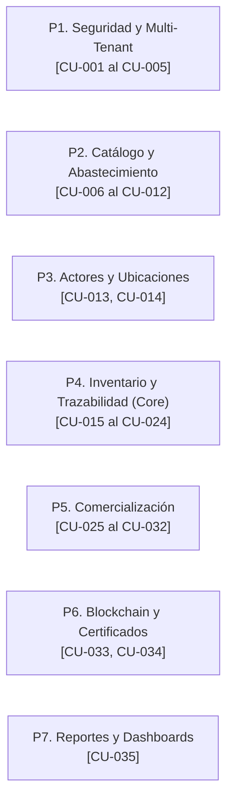

# Mapa Integral de Casos de Uso (Use Cases Map)

> **Documento:** Referencia Canónica de Casos de Uso (Diátaxis Framework)  
> **Ubicación:** `docs/USE_CASES_MAP.md`  
> **Metodología:** SCRUM · **Sprint Activo:** **Sprint 3**  
> **Estado de Implementación:** Sprints 0, 1 y 2 **Implementados y Verificados (120 tests verdes)**; Sprint 3 **En Desarrollo**; Sprint 4 **Planificado**  

---

## 1. Tabla Maestra Consolidada (35 Casos de Uso)

| ID | Caso de Uso | Descripción Breve | Actor(es) Principal(es) | Plataforma | Paquete | Sprint | Estado |
| :--- | :--- | :--- | :--- | :---: | :---: | :---: | :---: |
| **CU-001** | Gestionar Empresas (Tenants) | Configurar y administrar empresas importadoras con aislamiento de datos. | Super Administrador | Web | P1 | S0 | **Implementado** |
| **CU-002** | Gestionar Usuarios | Altas, bajas y edición de operadores dentro de cada empresa. | Admin Empresa, SuperAdmin | Web | P1 | S0 | **Implementado** |
| **CU-003** | Asignar Roles y Permisos | Gestión de privilegios RBAC para usuarios del tenant. | Admin Empresa | Web | P1 | S0 | **Implementado** |
| **CU-004** | Autenticación y Password | Login JWT, renovación de tokens y recuperación segura. | Todos los usuarios | Web / Móvil | P1 | S1 | **Implementado** |
| **CU-005** | Bitácora y Notificaciones | Auditoría de acciones sensibles y alertas de sistema. | SuperAdmin, Auditor | Web / Móvil | P1 | S4 / S0* | **Implementado** |
| **CU-006** | Productos y Variantes | Catálogo de dispositivos Apple (color, capacidad, SKU). | Admin Empresa | Web | P2 | S1 | **Implementado** |
| **CU-007** | Certificaciones Técnicas | Registro de normativas (FCC, CE, RoHS, Energy Star). | Admin Empresa | Web | P2 | S1 | **Implementado** |
| **CU-008** | Catálogo por Empresa | Precios, costos y activación de catálogo por importadora. | Admin Empresa | Web | P2 | S1 | **Implementado** |
| **CU-009** | Categorías de Producto | Organización taxonómica (iPhone, Mac, iPad, Accesorios). | SuperAdmin, Admin Empresa | Web | P2 | S1 | **Implementado** |
| **CU-010** | Órdenes de Compra | Creación de órdenes de importación a proveedores de EE.UU. | Gestor de Operaciones | Web | P2 | S2 | **Implementado** |
| **CU-011** | Aprobar / Rechazar Compra | Flujo de aprobación administrativa de órdenes pendientes. | Admin Empresa | Web | P2 | S2 | **Implementado** |
| **CU-012** | Recepción de Mercancía | Registro de llegada a almacén en Bolivia y existencias. | Gestor de Operaciones | Web | P2 | S2 | **Implementado** |
| **CU-013** | Actores de la Cadena | Registro maestro de proveedores, transportistas y aduanas. | Admin Empresa | Web | P3 | S1 | **Implementado** |
| **CU-014** | Ubicaciones Físicas | Almacenes, aduanas, puertos y tiendas con georreferencia. | Admin Empresa | Web | P3 | S1 | **Implementado** |
| **CU-015** | Unidades (Serial/IMEI/EID) | Registro físico individual de cada dispositivo Apple. | Gestor de Operaciones | Web | P4 | S2 | **Implementado** |
| **CU-016** | Generar y Descargar QR | Emisión de código QR único vinculado a serial/IMEI. | Gestor de Operaciones | Web | P4 | S2 | **Implementado** |
| **CU-017** | Escanear Código QR | Lectura con cámara o chip NFC para consultar historial. | Operaciones, Consumidor, Anónimo | Móvil | P4 | S3 | **En Desarrollo** |
| **CU-018** | Registrar Consulta Trace | Bitácora automática de cada escaneo (IP, fecha, país). | Sistema (Automático) | Backend | P4 | S3 | **Implementado** |
| **CU-019** | Envíos Logísticos | Despachos entre ubicaciones con ciclo de estados. | Gestor de Operaciones | Web | P4 | S2 | **Implementado** |
| **CU-020** | Asignar Unidades a Envío | Asociación y retiro de unidades específicas en envíos. | Gestor de Operaciones | Web | P4 | S2 | **Implementado** |
| **CU-021** | Eventos y Transporte | Registro de hitos y sensores (temperatura, vibración). | Gestor de Operaciones | Web / Móvil | P4 | S2 | **Implementado** |
| **CU-022** | Historial y Autenticidad | Cronología completa de la unidad y verificación original. | Consumidor, Anónimo, Auditor | Web / Móvil | P4 | S3 | **En Desarrollo** |
| **CU-023** | Reporte de Falsificación | Denuncia formal de equipo adulterado con evidencia. | Consumidor, Anónimo | Móvil | P4 | S3 | **En Desarrollo** |
| **CU-024** | Alertas e Incidencias | Gestión y resolución de anomalías logísticas en ruta. | Operaciones, Admin Empresa | Web / Móvil | P4 | S4 | **Implementado** |
| **CU-025** | Gestionar Ventas | Registro de salida comercial de unidades al consumidor. | Gestor de Ventas | Web | P5 | S4 | **Planificado** |
| **CU-026** | Asignar Unidades a Venta | Vinculación del serial/IMEI exacto al comprobante. | Gestor de Ventas | Web | P5 | S4 | **Planificado** |
| **CU-027** | Registrar Estado de Pago | Registro del estado de cobro (referencial, sin pasarela). | Gestor de Ventas, SuperAdmin | Web | P5 | S4 | **Planificado** |
| **CU-028** | Historial de Compras | Consulta de compras, unidades y favoritos del usuario. | Consumidor Registrado | Web / Móvil | P5 | S4 | **Planificado** |
| **CU-029** | Gestionar Devoluciones | Registro de devoluciones con justificación y estado. | Gestor de Ventas | Web | P5 | S4 | **Planificado** |
| **CU-030** | Asignar a Devolución | Reintegro físico de seriales a estado devuelto/almacén. | Gestor de Ventas | Web | P5 | S4 | **Planificado** |
| **CU-031** | Garantías por Unidad | Control de vigencia y términos de cobertura de garantía. | Gestor de Ventas, Consumidor | Web | P5 | S4 | **Planificado** |
| **CU-032** | Documentos de Unidades | Adjuntar facturas, pólizas aduaneras con hash SHA-256. | Gestor de Ventas | Web | P5 | S3 | **Implementado** |
| **CU-033** | Registrar en Blockchain | Notarización inmutable de eventos críticos en Ethereum. | Sistema (Web3 / Smart Contract) | Backend | P6 | S3 | **En Desarrollo** |
| **CU-034** | Consultar Blockchain y PDF | Verificación on-chain y descarga de certificado PDF. | Auditor, SuperAdmin, Consumidor | Web / Móvil | P6 | S3 | **En Desarrollo** |
| **CU-035** | Reportes y Dashboards | Métricas consolidadas de importación, tiempos y ventas. | Admin Empresa, SuperAdmin | Web | P7 | S4 | **Planificado** |

---

## 2. Organización por Paquetes de Dominio (7 Paquetes)

* **P1. Seguridad y Multi-Tenant (5 CUs):** `CU-001`, `CU-002`, `CU-003`, `CU-004`, `CU-005`. Todos implementados en backend.
* **P2. Catálogo y Abastecimiento (7 CUs):** `CU-006`, `CU-007`, `CU-008`, `CU-009`, `CU-010`, `CU-011`, `CU-012`. Todos implementados en backend y probados.
* **P3. Actores y Ubicaciones (2 CUs):** `CU-013`, `CU-014`. Implementados en backend y web.
* **P4. Inventario y Trazabilidad (Core) (10 CUs):** `CU-015`, `CU-016`, `CU-017`, `CU-018`, `CU-019`, `CU-020`, `CU-021`, `CU-022`, `CU-023`, `CU-024`. Núcleo transaccional del sistema.
* **P5. Comercialización (8 CUs):** `CU-025`, `CU-026`, `CU-027`, `CU-028`, `CU-029`, `CU-030`, `CU-031`, `CU-032`.
* **P6. Blockchain y Certificados (2 CUs):** `CU-033`, `CU-034`. Smart Contracts Solidity + Web3.py. Foco de desarrollo de **Sprint 3**.
* **P7. Reportes y Dashboards (1 CU transversal):** `CU-035`. Dashboards analíticos.

---

## 3. Matriz por Plataforma de Ejecución

### Exclusivos o Activos en Aplicación Móvil (Flutter)
* `CU-004`: Login móvil para operadores y consumidores.
* `CU-017`: **Escaneo nativo de QR / NFC con cámara móvil.** (Foco Sprint 3)
* `CU-021`: Registro en ruta de eventos y condiciones (temperatura/vibración).
* `CU-022`: Visualización interactiva del recorrido y autenticidad del dispositivo.
* `CU-023`: Denuncia y captura fotográfica de sospecha de falsificación.
* `CU-028`: Favoritos y consultas del consumidor registrado.
* `CU-034`: Visualización de certificados y estado en blockchain.

### Plataforma Web Administrativa (Angular)
* Administración multi-empresa (`CU-001`), usuarios (`CU-002`), roles (`CU-003`).
* Gestión completa de catálogo Apple (`CU-006` al `CU-009`).
* Gestión logística y órdenes de compra (`CU-010` al `CU-012`, `CU-019` al `CU-021`).
* Emisión y descarga de códigos QR masivos (`CU-016`).
* Gestión de ventas, garantías, devoluciones y reportes (`CU-025` al `CU-035`).

### Servicios Transversales de Backend (FastAPI / Cron / Eventos)
* `CU-005`: Middleware automático de auditoría en base de datos PostgreSQL.
* `CU-018`: Registro automático de telemetría y geolocalización aproximada de escaneos.
* `CU-033`: Conector Web3.py para firma y minado de transacciones en la red Ethereum.

---

## 4. Trazabilidad con Requisitos Funcionales (RF-01 a RF-30)

| Requisito Funcional | Casos de Uso que lo Implementan | Paquete | Sprint |
| :--- | :--- | :---: | :---: |
| **RF-01** (Autenticación) | CU-004 | P1 | S1 |
| **RF-02** (Roles y Permisos) | CU-002, CU-003 | P1 | S0 |
| **RF-03** (Registro de Usuarios) | CU-002, CU-004 | P1 | S0, S1 |
| **RF-04** (Recuperación Contraseña) | CU-004 | P1 | S1 |
| **RF-05** (Bitácora de Auditoría) | CU-005 | P1 | S0/S4 |
| **RF-06** (Gestión Multi-Tenant) | CU-001 | P1 | S0 |
| **RF-07** (Catálogo de Productos) | CU-006, CU-008 | P2 | S1 |
| **RF-08** (Categorías y Atributos) | CU-009 | P2 | S1 |
| **RF-09** (Certificaciones Técnicas) | CU-007 | P2 | S1 |
| **RF-10** (Órdenes de Compra) | CU-010, CU-011 | P2 | S2 |
| **RF-11** (Unidades Físicas) | CU-015 | P4 | S2 |
| **RF-12** (Códigos QR / NFC) | CU-016 | P4 | S2 |
| **RF-13** (Movimientos Logísticos) | CU-019, CU-020 | P4 | S2 |
| **RF-14** (Actores Externos) | CU-013, CU-021 | P3, P4 | S1, S2 |
| **RF-15** (Condiciones de Transporte) | CU-021 | P4 | S2 |
| **RF-16** (Incidencias y Alertas) | CU-024 | P4 | S4 |
| **RF-17** (Devoluciones y Garantías) | CU-029, CU-030, CU-031 | P5 | S4 |
| **RF-18** (Historial de Trazabilidad) | CU-022 | P4 | S3 |
| **RF-19** (Registro en Blockchain) | CU-033 | P6 | S3 |
| **RF-20** (Consulta Blockchain) | CU-034 | P6 | S3 |
| **RF-21** (Verificación Autenticidad) | CU-022 | P4 | S3 |
| **RF-22** (Escaneo QR/NFC Móvil) | CU-017 | P4 | S3 |
| **RF-23** (Consulta Pública sin Auth)| CU-016, CU-022 | P4 | S2, S3 |
| **RF-24** (Exposición API REST / Ext) | CU-018, CU-022 | P4 | S3 |
| **RF-25** (Favoritos y Preferencias)| CU-028 | P5 | S4 |
| **RF-26** (Reporte Falsificación) | CU-023 | P4 | S3 |
| **RF-27** (Generación Certificados) | CU-034 | P6 | S3 |
| **RF-28** (Descarga PDF) | CU-034 | P6 | S3 |
| **RF-29** (Notificaciones Push) | CU-005, CU-024 | P1, P4 | S4 |
| **RF-30** (Reportes y Dashboards) | CU-035 | P7 | S4 |
