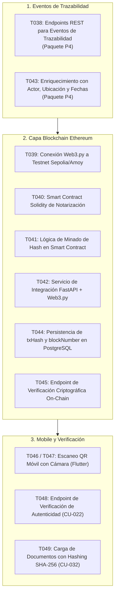

# Próximos Pasos Operativos (Next Steps - Agentes de IA)

> **Documento:** Checklist Táctico y Cola de Trabajo Inmediata para Agentes  
> **Ubicación:** `docs/ai/NEXT_STEPS.md`  
> **Metodología:** SCRUM · **Sprint Activo:** **Sprint 3 (Trazabilidad, Blockchain y Autenticidad)**  
> **Estado de Base de Código:** Sprints 0, 1 y 2 **100% Implementados y Verificados (120 tests verdes)**  

---

## 1. Contexto Operativo Inmediato

Nos encontramos en **SPRINT 3**. El equipo y los agentes tienen como misión completar la trazabilidad de unidades físicas y su anclaje criptográfico inmutable en la red blockchain.

Toda la base de los sprints anteriores (Multi-tenant, Usuarios, Roles, Catálogo Apple, Órdenes de Compra, Recepción, Unidades Serial/IMEI, QR y Envíos Logísticos) está construida y respaldada por **120 tests unitarios y de integración verdes en `trazabilidad/backend/tests/`**.

---

## 2. Cola de Tareas Inmediatas de Sprint 3 (T038–T049)

### Checklist Detallado de Ejecución

- [ ] **T038 (Backend P4):** Crear endpoints para registrar eventos físicos de trazabilidad y condiciones ambientales (temperatura, humedad, vibración) asociados a envíos y unidades.
- [ ] **T039 / T042 (Backend P6 / Web3):** Configurar el cliente `Web3.py` en `trazabilidad/backend/blockchain/` apuntando al RPC de Ethereum Sepolia/Amoy con clave privada almacenada en `.env`.
- [ ] **T040 / T041 (Solidity P6):** Finalizar y compilar el Smart Contract de trazabilidad (`contracts/Traceability.sol` o similar), exponiendo `recordEvent(uint256 unitId, bytes32 eventHash, uint8 eventType)`.
- [ ] **T044 (DB P4/P6):** Guardar en la tabla de eventos de PostgreSQL el `tx_hash`, `block_number` y estado de confirmación (`confirmado` / `pendiente`).
- [ ] **T045 / T048 (Backend P4/P6):** Implementar la verificación criptográfica que compara el hash recalculado de la base de datos contra el `eventHash` almacenado en el Smart Contract.
- [ ] **T049 (Backend P5):** Endpoint para adjuntar facturas y pólizas de importación a unidades, calculando y persistiendo su hash SHA-256.

---

## 3. Tareas Técnicas de Refactorización y Soporte

Antes o en paralelo con las tareas de Sprint 3, se debe ejecutar la siguiente optimización de bajo riesgo:

1. **Fachadas de Enrutamiento de los 7 Paquetes (`ADR-003`):**
   * Crear los archivos en `trazabilidad/backend/app/routers/`:
     * `p1_seguridad.py`
     * `p2_catalogo.py`
     * `p3_actores.py`
     * `p4_trazabilidad.py`
     * `p5_comercial.py`
     * `p6_blockchain.py`
     * `p7_reportes.py`
   * Importar en cada uno los controladores existentes correspondientes a sus Casos de Uso.
   * Modificar [main.py](file:///c:/Users/PERSONAL/Grupo5_si2/trazabilidad/backend/app/main.py) para que solo incluya los 7 routers con prefijo `/api/v1`.
   * **Validación obligatoria:** Correr `pytest tests/ -v` y comprobar que sigan pasando los **120 tests al 100%**.

---

## 4. Criterios de Aceptación para el Agente (DoD por Tarea)

1. **Aislamiento Multi-Tenant:** Cualquier endpoint creado debe recibir `tenant_id: int = Depends(resolve_tenant_id)` y aplicarlo en las consultas.
2. **Control de Acceso RBAC:** Rutas de mutación (`POST`, `PUT`, `DELETE`) deben incluir `dependencies=[Depends(require_roles([Rol.GESTOR_OPERACIONES, Rol.ADMIN_EMPRESA, ...]))]`.
3. **Tests Automatizados:** Cada CU nuevo debe incluir su archivo de prueba correspondiente en `trazabilidad/backend/tests/test_sprint3_*.py`.
4. **Actualización de Handoff:** Al finalizar cualquier intervención, actualizar inmediatamente `docs/ai/HANDOFF_LATEST.md` y `docs/ai/CURRENT_STATE.md`.
